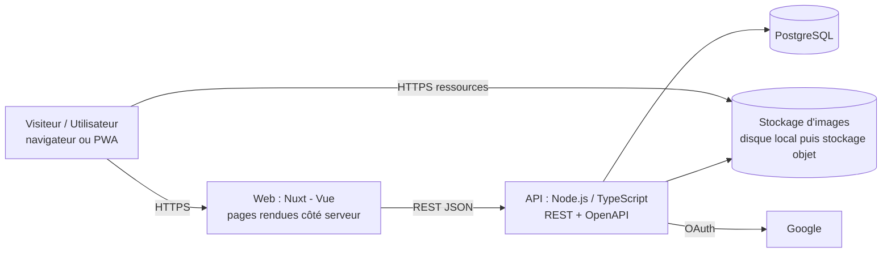

# Architecture

> Statut : brouillon v0.1 — 2026-10-09 — les décisions sont tracées en [ADR](adr/)

## 1. Vue d'ensemble

Tout tourne en local avec `docker compose up` (base, API, web). L'hébergement se choisit plus tard sans changer le code.

## 2. Briques et responsabilités
| Brique | Rôle | Choix |
|---|---|---|
| Base de données | Source de vérité du catalogue et des listes de lecture | PostgreSQL, migrations SQL versionnées, `pg_trgm` + `unaccent` pour la recherche |
| API | Règles métier, contrôle d'accès, validation, accès aux données | Node.js LTS + TypeScript, REST + OpenAPI, accès SQL typé |
| Web | Pages publiques indexables, zone connectée, administration | Nuxt (Vue 3), PWA |
| Stockage d'images | Couvertures redimensionnées | Disque local en développement, stockage objet compatible S3 en ligne |
| Authentification | Connexion sans mot de passe | Google OAuth, session en cookie `httpOnly` |

L'API est **indépendante du front** : elle sert le web aujourd'hui, une application native demain, et éventuellement des clients tiers.

## 3. Couches de l'API
Une requête traverse toujours `route → contrôleur → service → dépôt (repository) → base`, chaque couche ne connaissant que celle juste en dessous (discipline déjà éprouvée sur un projet précédent) :
- **routes** : URL et validation d'entrée ; **contrôleurs** : lecture HTTP, appel du service ;
- **services** : règles métier, sans HTTP ni SQL ; **dépôts** : seule couche qui écrit du SQL ;
- **middleware** : authentification, rôles, limitation de débit, gestion d'erreurs uniforme (codes stables).

### Routes du catalogue (`/api/v1`)
JSON en `camelCase`. Les valeurs d'énumération (`type`, `status`, `role`, `relation`…) sont des **codes stables** que le front traduit ; le front s'appuie sur `code` d'erreur, jamais sur `message`. Les œuvres archivées n'apparaissent jamais (liste ni fiche).
- `GET /works?q=&type=&status=&format=&genre=&originalLanguage=&lang=&sort=&page=&pageSize=` : liste paginée `{ items, page, pageSize, total }` (`page` ≥ 1, `pageSize` 1–50, défaut 20). `q` : 2 à 100 caractères, insensible à la casse et aux accents, tolère une faute légère ; chaque mot (6 au plus) doit correspondre à un titre, un titre alternatif, un auteur, un éditeur/plateforme, un format ou un genre (« aube manga » : titre + format). Quand aucune œuvre ne contient tous les mots, la liste donne celles qui en contiennent au moins un et la réponse porte `approximate: true`. `sort` : `relevance` (défaut ; classe par proximité du titre avec `q`, sinon par titre), `title` (titre affiché A→Z) ou `recent` (dernières ajoutées au catalogue d'abord) ; à égalité, titre puis `id`. `format` et `genre` : codes en slug (`manga`, `fantasy`), le premier limité à la catégorie `format`, le second à `theme`. `originalLanguage` : code ISO 639 en minuscules (`fr`, `ja`). Chaque filtre (`type`, `status`, `format`, `genre`, `originalLanguage`) accepte **plusieurs valeurs séparées par des virgules** (`status=ongoing,hiatus`, 10 au plus, doublons ignorés) : les valeurs d'un même filtre s'additionnent (OU), **sauf `genre` où chaque valeur doit être présente (ET)** ; les filtres entre eux se combinent (ET). Chaque élément : `id`, `title`, `originalTitle`, `originalLanguage`, `type`, `status`, `formats[]` (codes), `coverPath`, `mainAuthor`.
- `GET /works/facets?q=&type=&status=&format=&genre=&originalLanguage=` : nombre d'œuvres par valeur de filtre, pour les compteurs de la page de résultats. Réponse `{ type, status, format, genre, originalLanguage }`, chaque groupe étant `[{ code, count }]` trié par nombre décroissant puis code, valeurs à zéro omises. Chaque groupe applique la recherche et tous les autres filtres, mais pas le sien (on voit ce que donnerait un autre choix) ; le groupe `genre`, en ET, garde le sien : le compteur d'une valeur est le nombre d'œuvres qui l'ont en plus des genres déjà choisis. Mêmes paramètres et mêmes erreurs de validation que la liste, sans pagination ni `lang`, plus `match=any` pour suivre une liste passée aux résultats approchants (défaut `all`).
- `GET /works/:id?lang=` : fiche complète (`title` affiché, `originalTitle`, `originalLanguage`, `alternativeTitles[]` `{ language, kind, title }`, `synopsis` avec `synopsisLanguage` et `synopsisSource`, totaux `chapters`/`volumes` bruts, dates `YYYY-MM-DD`, crédits, éditeurs, `formats[]` et `genres[]` en codes, liens, relations, `memberCount` : lecteurs qui ont l'œuvre dans leur liste, profils privés inclus ; `ratingCount` et `ratingAverage` : moyenne sur une décimale, `null` sous 10 notes, RG-04). Les crédits sont regroupés par personne (`roles` : tableau ordonné `story`, `art`, `colors`, `other` ; `links[]` : sites et réseaux de la personne ; personnes triées par rôle le plus important puis par nom). Les relations ne sont stockées que dans un sens : `direction` vaut `outgoing` (cette œuvre est la source) ou `incoming` (elle est la cible) ; le front déduit le libellé inverse.
- `lang` (optionnel, liste fermée dans `api/src/config.ts`, ex. `fr`, `en` ; autre valeur : `VALIDATION_ERROR`) : langue de l'application. Le titre affiché (liste, fiche, œuvres liées) est le titre `translated` puis `international` de cette langue, sinon le titre original ; le synopsis est celui de cette langue, sinon celui de la langue originale (`null` s'il n'y en a aucun). Sans `lang`, tout est dans la langue originale. La recherche `q` porte sur les titres de toutes les langues.
- `GET /genres` : `{ items: [{ code, category }] }` (`category` : `format` ou `theme`), triés par catégorie puis par code ; le front traduit les codes et groupe l'affichage.
- `coverPath` est `null` tant que l'accord de l'auteur n'est pas enregistré (`cover_consent`).
- Erreurs : `{ code, message, details? }`. `VALIDATION_ERROR` (400) porte `details[]`, une entrée par champ : `path`, `code` Zod (`too_small`, `too_big`, `invalid_type`, `invalid_format`, `invalid_value`…) et les paramètres utiles (`expected`, `origin`, `minimum`, `maximum`, `format`, `values`), sans message ni valeur saisie. `NOT_FOUND` (404), `INVALID_JSON` (400), `INTERNAL_ERROR` (500). Le `message` de premier niveau est un texte technique en anglais, non affiché.
- Documentation OpenAPI 3.1 : `GET /api/v1/openapi.json`, générée depuis les schémas Zod des routes (entrées) et des réponses (`api/src/openapi/`). Une interface de lecture (Scalar) est servie sur `/docs` **hors production seulement**. Des tests de contrat vérifient que les routes montées et la spécification se correspondent, et que les réponses réelles respectent leurs schémas.

## 4. Flux principaux
- **Page de fiche** : le visiteur demande `/work/42-aube-fictive` (ou `/en/work/42-aube-fictive`) → Nuxt appelle l'API → HTML rendu côté serveur → hydratation côté navigateur.
- **Mise à jour de progression** : navigateur → API (`PUT` sur l'entrée de liste) → vérification de session → base ; le journal de lecture est alimenté si activé.
- **Soumission** : formulaire → API → table `submission` → revue par l'administrateur → création de la fiche.
- **Image** : upload par l'administrateur → génération de 2–3 tailles WebP → stockage ; la base ne garde que le chemin.

## 5. Stratégie mobile
Échelle, du moins risqué au plus engageant :
1. **Web + PWA** (0 €) — décision actuelle ;
2. éventuellement **Android** (Play Store) ;
3. éventuellement **iOS** via Capacitor, seulement si un besoin est confirmé et avec de vraies fonctions natives (règle 4.2 d'Apple) ;
4. plan B : application native (Expo/React Native) consommant la **même API**.
Voir [ADR 0003](adr/0003-mobile-pwa-d-abord.md).

## 6. Alternatives écartées
| Alternative | Raison |
|---|---|
| Supabase (backend tout prêt) | RLS/RPC moins familiers et moins « reprenables » qu'une API REST ; logique éparpillée ; free tier qui s'endort ; pas d'API ouverte propre. Reste utilisable plus tard comme simple PostgreSQL hébergé |
| TypeORM | SQL caché, décorateurs imposant une étape de compilation ; on préfère un accès SQL typé |
| React Native / Expo dès le départ | SEO web plus faible, nouvel écosystème ; gardé comme plan B natif |
| Flutter | SEO web médiocre, écosystème à part |
| SQLite / NoSQL | Mal adaptés à un modèle très relationnel et multi-utilisateurs |
| Scraping de sources tierces | Droits, fragilité ; saisie directe + soumissions |

## 7. Qualité et exploitation
Voir [conventions-projet.md](conventions-projet.md) (CI, hooks, tests) et [exigences-non-fonctionnelles.md](exigences-non-fonctionnelles.md).

## 8. Format d'un ADR
Chaque décision structurante a un fichier `adr/NNNN-titre.md` : **Statut, Date, Contexte, Décision, Alternatives, Conséquences**. Un ADR ne se réécrit pas : on le remplace par un nouvel ADR qui le déclare « remplacé ».

Index : [0001 Stack](adr/0001-stack.md) · [0002 Données hors git](adr/0002-donnees-hors-git.md) · [0003 Mobile : PWA d'abord](adr/0003-mobile-pwa-d-abord.md) · [0005 Modèle calqué sur MAL](adr/0005-modele-calque-sur-mal.md)
