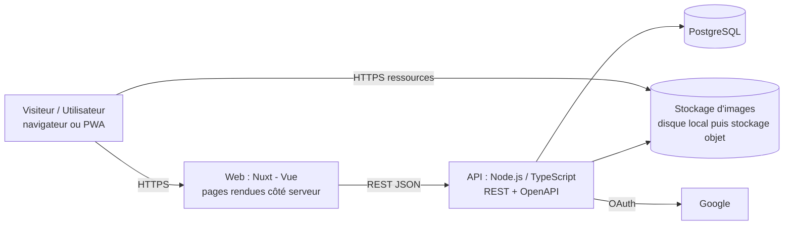

# Architecture

> Statut : brouillon v0.1 — 2026-10-09 — les décisions sont tracées en [ADR](adr/)

## 1. Vue d'ensemble

Tout tourne en local avec `docker compose up` (base, API, web). L'hébergement se choisit plus tard sans changer le code.

## 2. Briques et responsabilités
| Brique | Rôle | Choix |
|---|---|---|
| Base de données | Source de vérité du catalogue et des bibliothèques | PostgreSQL, migrations SQL versionnées, `pg_trgm` + `unaccent` pour la recherche |
| API | Règles métier, contrôle d'accès, validation, accès aux données | Node.js LTS + TypeScript, REST + OpenAPI, accès SQL typé |
| Web | Pages publiques indexables, zone connectée, administration | Nuxt (Vue 3), PWA |
| Stockage d'images | Couvertures redimensionnées | Disque local en développement, stockage objet compatible S3 en ligne |
| Authentification | Connexion sans mot de passe | Google OAuth, session en cookie `httpOnly` |

L'API est **indépendante du front** : elle sert le web aujourd'hui, une application native demain, et éventuellement des clients tiers.

## 3. Couches de l'API
Une requête traverse toujours `route → contrôleur → service → dépôt (repository) → base`, chaque couche ne connaissant que celle juste en dessous (discipline déjà éprouvée sur un projet précédent) :
- **routes** : URL et validation d'entrée ; **contrôleurs** : lecture HTTP, appel du service ;
- **services** : règles métier, sans HTTP ni SQL ; **dépôts** : seule couche qui écrit du SQL ;
- **middleware** : authentification, rôles, limitation de débit, gestion d'erreurs uniforme (codes stables).

### Routes du catalogue (`/api/v1`)
JSON en `camelCase`. Les valeurs d'énumération (`type`, `status`, `role`, `relation`…) sont des **codes stables** que le front traduit ; le front s'appuie sur `code` d'erreur, jamais sur `message`. Les œuvres archivées n'apparaissent jamais (liste ni fiche).
- `GET /works?q=&type=&status=&genre=&page=&pageSize=` : liste paginée `{ items, page, pageSize, total }` (`page` ≥ 1, `pageSize` 1–50, défaut 20). `q` : 2 à 100 caractères, insensible à la casse et aux accents, tolère une faute légère, porte sur titre, titres alternatifs, auteurs et éditeurs/plateformes. `genre` : libellé exact. Chaque élément : `id`, `title`, `type`, `status`, `coverPath`, `mainAuthor`.
- `GET /works/:id` : fiche complète (totaux `chapters`/`volumes` bruts, dates `YYYY-MM-DD`, titres alternatifs, crédits, éditeurs, genres, liens, relations). Les crédits sont regroupés par personne (`roles` : tableau ordonné `story`, `art`, `colors`, `other` ; personnes triées par rôle le plus important puis par nom). Les relations ne sont stockées que dans un sens : `direction` vaut `outgoing` (cette œuvre est la source) ou `incoming` (elle est la cible) ; le front déduit le libellé inverse.
- `coverPath` est `null` tant que l'accord de l'auteur n'est pas enregistré (`cover_consent`).
- Erreurs : `VALIDATION_ERROR` (400), `NOT_FOUND` (404).

### Évolution prévue (ADR 0007, tickets #50 à #53)
- Paramètre `lang` sur `GET /works` et `GET /works/:id` ; la fiche renvoie `displayTitle`, `titles[]`, `synopsisLanguage` et `synopsisSource`.
- `genre` filtré et renvoyé par code ; `GET /genres` renvoie des codes. Les valeurs d'énumération sont déjà en anglais (#50).
- Erreurs de validation : `details[]` porte `path`, `code` et paramètres, sans message ; le front lit `code`, jamais `message`.

## 4. Flux principaux
- **Page de fiche** : le visiteur demande `/oeuvre/42-ripper` → Nuxt appelle l'API → HTML rendu côté serveur → hydratation côté navigateur.
- **Mise à jour de progression** : navigateur → API (`PUT` sur l'entrée de bibliothèque) → vérification de session → base ; le journal de lecture est alimenté si activé.
- **Soumission** : formulaire → API → table `submission` → revue par l'administrateur → création de la fiche.
- **Image** : upload par l'administrateur → génération de 2–3 tailles WebP → stockage ; la base ne garde que le chemin.

## 5. Stratégie mobile
Échelle, du moins risqué au plus engageant :
1. **Web + PWA** (0 €) — décision actuelle ;
2. éventuellement **Android** (Play Store) ;
3. éventuellement **iOS** via Capacitor, seulement si un besoin est confirmé et avec de vraies fonctions natives (règle 4.2 d'Apple) ;
4. plan B : application native (Expo/React Native) consommant la **même API**.
Voir [ADR 0003](adr/0003-mobile-pwa-d-abord.md).

## 6. Alternatives écartées
| Alternative | Raison |
|---|---|
| Supabase (backend tout prêt) | RLS/RPC moins familiers et moins « reprenables » qu'une API REST ; logique éparpillée ; free tier qui s'endort ; pas d'API ouverte propre. Reste utilisable plus tard comme simple PostgreSQL hébergé |
| TypeORM | SQL caché, décorateurs imposant une étape de compilation ; on préfère un accès SQL typé |
| React Native / Expo dès le départ | SEO web plus faible, nouvel écosystème ; gardé comme plan B natif |
| Flutter | SEO web médiocre, écosystème à part |
| SQLite / NoSQL | Mal adaptés à un modèle très relationnel et multi-utilisateurs |
| Scraping de sources tierces | Droits, fragilité ; saisie directe + soumissions |

## 7. Qualité et exploitation
Voir [conventions-projet.md](conventions-projet.md) (CI, hooks, tests) et [exigences-non-fonctionnelles.md](exigences-non-fonctionnelles.md).

## 8. Format d'un ADR
Chaque décision structurante a un fichier `adr/NNNN-titre.md` : **Statut, Date, Contexte, Décision, Alternatives, Conséquences**. Un ADR ne se réécrit pas : on le remplace par un nouvel ADR qui le déclare « remplacé ».

Index : [0001 Stack](adr/0001-stack.md) · [0002 Données hors git](adr/0002-donnees-hors-git.md) · [0003 Mobile : PWA d'abord](adr/0003-mobile-pwa-d-abord.md) · [0005 Modèle calqué sur MAL](adr/0005-modele-calque-sur-mal.md)
