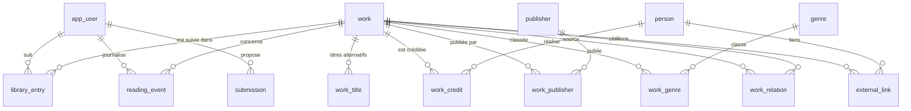

# Modèle de données

> Statut : brouillon v0.1 — 2026-10-09 — base de travail, à valider par les jeux d'acceptation (section 7)

Modèle calqué sur MyAnimeList : une œuvre = une fiche, compteurs chapitres/tomes indépendants, pas de notion d'édition. SGBD : **PostgreSQL**. Conventions : tables et colonnes en `snake_case` anglais, clés `bigint generated always as identity`, dates en `timestamptz` (sauf dates calendaires en `date`), énumérations en `text` + `CHECK` (plus simples à migrer qu'un type `ENUM`), suppression douce par `deleted_at` / `deleted_by`.

## 1. Schéma entité-relation

## 2. Définition de chaque table
| Table | Définition (à quoi elle sert) | Clé | Qui l'alimente |
|---|---|---|---|
| `app_user` | Un compte utilisateur, créé à la première connexion Google. Porte l'identité publique (handle), le rôle (`user` / `admin`) et la visibilité du profil | `id` | L'utilisateur (connexion) ; l'admin pour le rôle |
| `work` | **Table centrale** : une œuvre du catalogue (série, one-shot, webcomic ou recueil), quel que soit le nombre de supports. Contient les informations de la fiche et la couverture | `id` | Admin (ou soumission acceptée) |
| `work_title` | Titres alternatifs d'une œuvre (ancien titre, traduction, titre court) pour retrouver l'œuvre en recherche | (`work_id`, `title`) | Admin |
| `work_relation` | Lien orienté entre deux œuvres : suite, préquelle, spin-off, histoire annexe, adaptation, version alternative, même univers, contient (recueil), autre | (`work_id`, `related_work_id`, `relation`) | Admin |
| `person` | Un auteur ou un collectif (scénariste, dessinateur, coloriste…) sous le nom sous lequel il est crédité | `id` | Admin |
| `work_credit` | Association œuvre ↔ personne avec un **rôle** (scénario, dessin, couleur, autre). Une œuvre peut avoir plusieurs auteurs, une personne plusieurs œuvres | (`work_id`, `person_id`, `role`) | Admin |
| `publisher` | Une structure qui publie : maison d'édition (Pika Édition, Ankama…), plateforme de lecture (Webtoon, Mangadraft) ou entrée « auto-édition » | `id` | Admin |
| `work_publisher` | Association œuvre ↔ éditeur/plateforme. Une œuvre peut en avoir plusieurs (BICLY : plateforme + éditeur papier) ou aucun | (`work_id`, `publisher_id`) | Admin |
| `genre` | Étiquettes de classement (manga, BD, fantasy, humour…). Sert aux filtres, pas à la structure | `id` | Admin |
| `work_genre` | Association œuvre ↔ genre (plusieurs genres par œuvre) | (`work_id`, `genre_id`) | Admin |
| `external_link` | Un lien externe rattaché **soit** à une œuvre, **soit** à une personne : où lire, où acheter, site, réseau social | `id` | Admin |
| `library_entry` | **Le suivi d'une œuvre par un utilisateur** : statut de lecture, chapitres lus, tomes lus, note, dates. Une seule ligne par couple utilisateur/œuvre | (`user_id`, `work_id`) | L'utilisateur |
| `reading_event` | Journal en ajout seul des progressions de lecture, pour l'historique et le bilan annuel | `id` | L'API, automatiquement |
| `submission` | Une proposition d'œuvre faite par un utilisateur, en attente d'une décision de l'admin (contient les champs proposés en JSON) | `id` | L'utilisateur ; l'admin la traite |

**Lecture d'ensemble** : le **catalogue** (`work`, `person`, `publisher` et leurs tables d'association) est alimenté par l'administrateur ; la partie **utilisateur** (`app_user`, `library_entry`, `reading_event`) par les utilisateurs ; `submission` fait le pont entre les deux.

## 3. Dictionnaire de données

### `app_user`
| Colonne | Type | Contraintes / règle |
|---|---|---|
| id | bigint identity | PK |
| email | text | NOT NULL, unique (insensible à la casse) |
| google_sub | text | NOT NULL, unique — identifiant Google du compte |
| handle | citext | NOT NULL, unique, 3–30 car. `[a-z0-9_-]`, liste de mots réservés |
| display_name | text | nullable |
| role | text | NOT NULL, `user` \| `admin`, défaut `user` |
| profile_visibility | text | NOT NULL, `public` \| `private`, **défaut `public`** |
| created_at | timestamptz | NOT NULL, défaut `now()` |
| deleted_at | timestamptz | nullable (suppression de compte) |

### `work`
| Colonne | Type | Contraintes / règle |
|---|---|---|
| id | bigint identity | PK — identifiant interne (`trame_id`), fait foi dans l'URL |
| title | text | NOT NULL |
| type | text | NOT NULL, `serie` \| `oneshot` \| `webcomic` \| `recueil` |
| status | text | NOT NULL, `a_venir` \| `en_cours` \| `termine` \| `en_pause` \| `abandonne` |
| synopsis | text | nullable |
| chapters | integer | nullable, ≥ 0 — nombre **total** de chapitres/épisodes ; **renseigné seulement quand l'œuvre est terminée** (NULL = inconnu / en cours, affiché « ? » comme sur MAL) |
| volumes | integer | nullable, ≥ 0 — nombre **total** de tomes ; même règle : NULL tant que l'œuvre est en cours, affiché « ? » |
| started_on | date | nullable |
| ended_on | date | nullable, ≥ started_on |
| cover_path | text | nullable — chemin dans le stockage d'images |
| cover_source_url | text | nullable — provenance de la couverture |
| cover_consent | boolean | NOT NULL, défaut false — accord de l'auteur/éditeur |
| created_at / updated_at | timestamptz | NOT NULL |
| deleted_at / deleted_by | timestamptz / bigint FK `app_user` | nullable — archivage |

Index : GIN trigram sur `title` (`pg_trgm` + `unaccent`) ; index sur `type`, `status`, `deleted_at`.

### `work_title`
`work_id` FK, `title` text NOT NULL. Titres alternatifs (traductions, anciens titres). PK (`work_id`, `title`).

### `work_relation`
| Colonne | Type | Règle |
|---|---|---|
| work_id | bigint FK `work` | NOT NULL — œuvre source |
| related_work_id | bigint FK `work` | NOT NULL, ≠ work_id |
| relation | text | NOT NULL, `suite` \| `prequelle` \| `spin_off` \| `histoire_annexe` \| `adaptation` \| `version_alternative` \| `meme_univers` \| `contient` \| `autre` |
PK (`work_id`, `related_work_id`, `relation`). Un seul sens est stocké ; l'inverse (suite ↔ préquelle, contient ↔ fait partie de, spin_off ↔ a pour spin-off) est déduit à l'affichage. **Lecture : « `work_id` — relation — `related_work_id` »**, par exemple « Fabula Fantasia — `spin_off` — Radiant » ou « Dreamland Le Mook — `contient` — Tokyo Trip ». Par défaut, une seule relation principale par paire d'œuvres.

### `person`
`id` PK, `name` text NOT NULL (pseudonyme ou nom d'usage), `kind` text `personne` \| `collectif` (défaut `personne`), `deleted_at`. Pas d'e-mail ni de donnée privée.

### `work_credit`
`work_id`, `person_id`, `role` (`scenario` \| `dessin` \| `couleur` \| `autre`). PK (`work_id`, `person_id`, `role`).

### `publisher`
`id` PK, `name` text NOT NULL, `kind` text `editeur` \| `plateforme` \| `auto`, `url` nullable, `deleted_at`.

### `work_publisher`
`work_id`, `publisher_id`. PK composite. Facultatif : une œuvre peut n'avoir aucun éditeur (auto-édition sans structure).

### `genre` / `work_genre`
`genre(id, label unique)` ; `work_genre(work_id, genre_id)`. Les étiquettes « manga » et « BD » vivent ici.

### `external_link`
| Colonne | Type | Règle |
|---|---|---|
| id | bigint identity | PK |
| work_id | bigint FK nullable | exactement l'un de `work_id` / `person_id` est renseigné (`CHECK`) |
| person_id | bigint FK nullable | idem |
| kind | text | `lire` \| `acheter` \| `site` \| `reseau` |
| url | text | NOT NULL, `https://` uniquement (`CHECK`) |
| label | text | nullable |

### `library_entry`
| Colonne | Type | Règle |
|---|---|---|
| user_id | bigint FK `app_user` | NOT NULL |
| work_id | bigint FK `work` | NOT NULL |
| status | text | NOT NULL, `en_cours` \| `termine` \| `a_lire` \| `en_pause` \| `abandonne` |
| chapters_read | integer | NOT NULL, défaut 0, `CHECK >= 0` |
| volumes_read | integer | NOT NULL, défaut 0, `CHECK >= 0` |
| rating | smallint | nullable, `CHECK BETWEEN 1 AND 10` |
| started_on / finished_on | date | nullable |
| updated_at | timestamptz | NOT NULL |
PK (`user_id`, `work_id`). **Aucune contrainte de cohérence entre `chapters_read` et `volumes_read`** (choix assumé : les deux unités ne sont jamais mappées).

### `reading_event`
| Colonne | Type | Règle |
|---|---|---|
| id | bigint identity | PK |
| user_id / work_id | bigint FK | NOT NULL |
| kind | text | NOT NULL, `chapters` \| `volumes` \| `status` \| `rating` — ce qui a changé |
| chapters_added | integer | chapitres lus en plus ; renseigné seulement si `kind = chapters` |
| volumes_added | integer | tomes lus en plus ; renseigné seulement si `kind = volumes` |
| new_status | text | statut de lecture atteint (mêmes valeurs que `library_entry.status`) ; seulement si `kind = status` |
| new_rating | smallint | note donnée, 1 à 10 ; seulement si `kind = rating` |
| occurred_at | timestamptz | NOT NULL, défaut `now()` |

Une `CHECK` impose qu'une seule colonne de valeur soit renseignée, celle qui correspond au `kind`. Table en ajout seul, alimentée côté API ; sert à l'historique et au bilan annuel (somme de `chapters_added` / `volumes_added`).

### `submission`
`id` PK, `payload` jsonb NOT NULL (champs proposés), `status` (`en_attente` \| `acceptee` \| `refusee`), `submitted_by` FK, `reviewed_by` FK nullable, `dedupe_candidates` jsonb nullable, `created_at`, `reviewed_at`.

## 4. Règles transverses
- **Identité** : l'`id` de `work` est la seule clé de référence ; l'URL publique est `/oeuvre/{id}-{slug}` et seul `{id}` est lu.
- **Archivage** : toute suppression est une suppression douce, réservée à l'administrateur ; les listes publiques excluent `deleted_at IS NOT NULL`.
- **Pas d'ISBN, pas d'édition** dans le MVP.
- **Statistiques** : ne jamais additionner chapitres et tomes.
- **Recherche** : `pg_trgm` + `unaccent` sur `work.title`, `work_title.title`, `person.name`, `publisher.name`.
- **Erreurs API** : codes stables (ex. `WORK_NOT_FOUND`, `ADMIN_REQUIRED`, `HANDLE_TAKEN`).

## 5. Hors MVP mais compatible
votes, listes personnalisées, ISBN, table d'éditions. **Volontairement hors Trame** : calendrier des sorties à venir (rôle de MangaCollec) ; chapitres intermédiaires (10.5) et postfaces.

## 6. Ce que le modèle n'impose pas volontairement
Pas de mapping chapitre ↔ tome ; pas de limite de `chapters_read` par rapport à `work.chapters` ; pas d'entité « saison » (une saison 2 reste la même fiche sauf série clairement distincte).

## 7. Jeux d'acceptation (à saisir avant tout code)
Chaque cas doit entrer proprement dans le modèle, sans contournement. Les informations proviennent de Ryan ; les points entre crochets restent **à confirmer**.

| Cas | Ce qu'il teste |
|---|---|
| **BICLY** (*Because I Can't Love You*) — Lief | `type = webcomic` ; statut `termine`, donc totaux renseignés : `chapters = 158` (épisodes) ; **postface** : voir note ci-dessous ; édition papier chez Vega, `volumes = 4` ; **deux** `work_publisher` (plateforme **Webtoon** + éditeur Vega) ; lien « lire » (Webtoon) et lien « acheter » (Vega) ; crédit Lief ; genre `manga`/webtoon |
| **Dreamland** — Reno Lemaire | `type = serie` ; en cours : `volumes` et `chapters` non renseignés (affichés « ? » ; 24 tomes parus, non saisis) ; éditeur **Pika Édition** (`kind = editeur`) ; une seule personne créditée **deux fois** (rôles `scenario` et `dessin`, clé (`work_id`, `person_id`, `role`)) ; statut `en_cours` ; genre `manga` |
| **Ripper** — Jeronimo Cejudo | `type = serie` ; en cours : `volumes` non renseigné (« ? ») ; éditeur **Ankama** ; **6ᵉ tome annoncé pour fin novembre 2026** (voir note ci-dessous) ; genre `manga` |
| **Space Punch** — Zd. | `type = serie` ; en cours : `volumes` non renseigné (« ? ») ; éditeur **Ankama** (même `publisher` que Ripper : vérifie le partage d'un éditeur entre plusieurs œuvres et la page éditeur) ; statut `en_cours` ; auteur crédité en `scenario` et `dessin` ; genre `manga` |
| **Akimbo** — Djiguito | `type = oneshot` ; `volumes = 1` ; **auto-édition** (`publisher` de `kind = auto` ou aucun éditeur) ; statut `termine` ; pas d'ISBN ; lien de la boutique ou du site de l'auteur ; genre `manga` |
| **Dreamland – Tokyo Trip** — Reno Lemaire | `type = oneshot` (hors-série d'environ 40 pages) ; `volumes = 1` ; relation **`spin_off`** vers Dreamland (et affichage de l'inverse sur la fiche Dreamland) ; **auto-édition** (`publisher` de `kind = auto`) alors que Dreamland est chez Pika Édition : un même auteur peut donc avoir des œuvres à éditeurs différents ; une fiche unique même s'il paraît aussi dans le Mook |
| **Dreamland Le Mook** — Reno Lemaire + artistes invités | `type = recueil` ; `volumes = 1` ; éditeur **Pika Édition** ; relation **`contient`** vers *Tokyo Trip* et relation **`meme_univers`** vers Dreamland (confirmé : bonus « coulisses de Dreamland » avec quelques one-shots) ; plusieurs crédits (Reno Lemaire + artistes invités, rôle `autre` ou `dessin`) ; histoires inédites et one-shots **sans fiche propre** tant qu'ils ne sont pas publiés seuls ; sortie annoncée en septembre 2026 → fiche créée une fois paru (RG-15) |
| Une œuvre **auto-éditée** sans éditeur | `kind = auto` ou aucun `work_publisher`, pas de ISBN |
| **Radiant** — Tony Valente | `type = serie` ; statut `en_cours`, donc `volumes` et `chapters` non renseignés (« ? ») ; éditeur **Ankama** ; fiche d'origine de la famille Radiant : la liste de ses spin-offs s'affiche par déduction de l'inverse |
| **Fabula Fantasia** (spin-off de Radiant) | `type = serie` ; statut `en_cours`, `volumes` non renseigné (« ? ») ; éditeur **Ankama** (même `publisher` que Radiant, Ripper et Space Punch) ; relation **`spin_off`** vers Radiant (se situe avant Radiant et se lit indépendamment : précisé dans le synopsis) |
| **Radiant – Cyfandir Chronicles** (spin-off de Radiant) | `type = serie` ; statut `en_cours`, `volumes` non renseigné (« ? ») ; éditeur **Ankama** ; relation **`spin_off`** vers Radiant (se situe après l'arc de Cyfandir : précisé dans le synopsis) ; **deux personnes créditées** : Tony Valente (`scenario`, aussi crédité sur Radiant) et Naokuren (`dessin`) ; Radiant a désormais deux spin-offs (liste déduite de l'inverse) |

**Constat : les dix cas entrent dans le modèle sans contournement.** Aucun exemple réel de suite ou de préquelle n'existe dans le périmètre actuel : ces types de relation sont conservés (standard MAL, coût nul) sans jeu d'acceptation. Règles de saisie confirmées par Ryan (2026-10-09) :
1. **BICLY** : `chapters = 158` ; la **postface n'est pas comptée** (elle peut être mentionnée dans le synopsis ou une note).
2. **Chapitres intermédiaires** (ex. 10.5), postfaces, bonus : **non comptés** ; `chapters` et `chapters_read` restent des entiers.
3. **Parutions à venir** (ex. tome 6 de Ripper, annoncé fin novembre 2026) : **non modélisées** — le modèle ne décrit que ce qui est paru. C'est le rôle d'outils de calendrier de sorties comme MangaCollec, pas de Trame. Ripper étant en cours, `volumes` reste vide.
7. **Totaux des œuvres en cours** : `chapters` et `volumes` ne sont **pas saisis** tant que l'œuvre est en cours (affichés « ? », ex. « chapitres 100/? · tomes 12/? »). On les renseigne quand l'œuvre passe à `termine`. Cela évite des fiches périmées à chaque nouvelle parution.
4. **Un hors-série qui paraît aussi dans un recueil** (Tokyo Trip dans le Mook) = **une seule fiche**, liée au recueil par `contient` et à la série d'origine par `spin_off`.
5. **Récits inédits d'un recueil** : pas de fiche tant qu'ils ne sont pas publiés seuls ; ils sont décrits dans le synopsis et crédités sur le recueil.
6. **Une seule relation principale par paire d'œuvres** (ex. `spin_off` pour Fabula Fantasia, même s'il est aussi une préquelle). La chronologie se précise dans le synopsis. Le modèle autorise techniquement une seconde relation, à n'utiliser qu'exceptionnellement.
